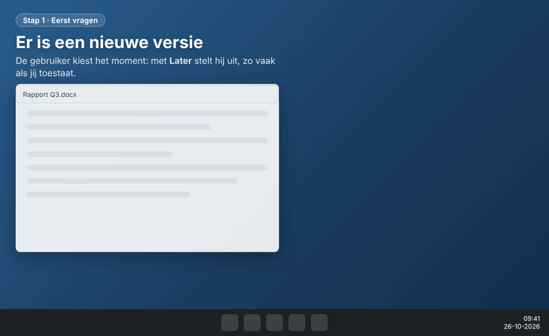

# AppUpdateKit – update-pakketten met popup, voor elke app

> 📖 Uitleg met screenshots op mijn blog: [AppUpdateKit: app-updates via Intune met een nette popup](https://fonferek.cloud/blog/appupdatekit-app-updates-met-popup-in-intune/).

<p align="center">
  
</p>

Elke app krijgt dezelfde vensters:
- **"Update beschikbaar"** rechtsonder, met het logo van de app en de knoppen *Later* / *Nu bijwerken*.
- **Na de laatste keer uitstellen**: een waarschuwing "De update start over 5 minuten", met aftelklok en alleen de knop *Nu installeren*.
- **Melding tijdens de installatie** met voortgangsbalk.
- **Melding na afloop**: "geïnstalleerd" (groen) of "niet gelukt" (rood).

## Waarom deze kit?

Wie apps uitrolt en bijwerkt met Intune, loopt vaak tegen dezelfde dingen aan. Dit doet de kit eraan:

| Waar je tegenaan loopt | Wat de kit doet |
|---|---|
| Intune installeert een update terwijl iemand de app gebruikt. De app wordt gesloten, of de installatie mislukt. | Eerst controleren of de app openstaat. Zo ja, dan krijgt de gebruiker de popup en probeert Intune het later opnieuw (exitcode 1618). |
| Gebruikers kunnen een update niet uitstellen. | Een knop *Later*, met een maximum dat jij kiest. Na de laatste keer komt een waarschuwing met aftelklok. |
| De installatie draait als SYSTEM: de gebruiker ziet niets en belt de servicedesk. | Popups in de sessie van de gebruiker: update beschikbaar, bezig (met voortgangsbalk), gelukt of niet gelukt. Met je eigen logo en kleur. |
| Updates midden op de werkdag. | Een tijdvenster (binnen of buiten werktijd), direct installeren als iemand inactief is of het scherm vergrendeld is, of als niemand is ingelogd. |
| Na een installatie die een herstart nodig heeft, krijgt de gebruiker geen duidelijke keuze. | Een herstartmelding alleen als het nodig is, met *Later*, een deadline en een aftelklok. Intune krijgt exitcode 0, zodat er geen tweede melding komt. |
| Voor elke app opnieuw een installatiescript, detectie en requirement schrijven. | De Builder leest de installer, vult naam, versie en stille parameters in, en maakt alle scripts en een lijst met de Intune-instellingen. |
| Een runtime, de app en een configuratiescript in één pakket, in de goede volgorde. | Eén tabel met onderdelen, elk met eigen parameters en geslaagde exitcodes. Mislukt er een, dan stopt de installatie. |
| Na verwijderen blijven snelkoppelingen, registerwaarden of bestanden achter. | De Builder maakt de verwijderstappen zelf, ook voor je eigen scripts: hij leest wat ze aanmaken en zet erbij hoe het weer weg moet. |
| Een andere tekst of parameter betekent opnieuw verpakken en uploaden. | Met de PowerShell-installer staan de instellingen, teksten en stappen in `Install.ps1`. Je past ze aan in Intune, zonder nieuw pakket. |
| Een typfout in een stille parameter ontdek je pas als het op alle laptops mislukt. | De Builder en het bouwscript controleren dat vooraf, bijvoorbeeld `msiexec ... /s` (foutcode 1639). |
| Popups tijdens Autopilot. | Tijdens de inrichting installeert het pakket stil, zonder popup. Eén Intune-app voor nieuwe laptops én updates. |

## De makkelijkste manier: de Builder

Eenmalig na het uitpakken, in PowerShell: `Get-ChildItem C:\AppUpdateKit -Recurse | Unblock-File`

Dubbelklik daarna op **`Start-Builder.cmd`**. Na de eerste keer kun je ook de snelkoppeling **AppUpdateKit Builder** gebruiken. De eerste keer vraagt de Builder om een standaardmap voor je installers (zie hieronder). Met *Volgende* en *Vorige* linksonder loop je de tabbladen één voor één door.

1. Klik op **+ Nieuwe app** en geef een AppId op (bijv. `7Zip`). Of kies links een bestaande app.
2. **Tabblad 1 – Basis.** Klik op *Kiezen...* bij Installer. Bij een `.msi` of `.exe` worden naam, versie, type en stille parameters herkend en ingevuld. Bij een `.exe` herkent de Builder NSIS, Inno Setup, InstallShield en WiX; is het type onbekend, dan vul je de stille parameters zelf in (tabblad 2). Vul daarna de processen in en kies een logo en een kleur. Het logo mag een `.svg`, `.png`, `.jpg` of `.ico` zijn. Een SVG wordt met Microsoft Edge omgezet naar een scherp icoon van 256×256, en het origineel blijft als `logo.svg` in de app-map bewaard. Met *Uit installer halen* haalt de Builder het logo uit een `.exe` (de grootste versie, tot 256×256) of uit een `.msi` (het pictogram dat de MSI voor *Apps en onderdelen* gebruikt).
3. **Tabblad 2 – Installatie.**
   - **Onderdelen:** alles wat in dit pakket geïnstalleerd wordt, in volgorde. Bijvoorbeeld eerst een runtime, dan de app. Per onderdeel stel je eigen **parameters** in en de **exitcodes die als geslaagd tellen**. Wijzigen doe je door te dubbelklikken. Het hoofdonderdeel is de app zelf. Mislukt een onderdeel, dan stopt de installatie en krijgt de gebruiker "Update niet gelukt".
   - **Extra stappen vóór en na** de onderdelen, bijvoorbeeld snelkoppelingen of een configuratiebestand kopiëren.
   - Hieruit wordt `install-app.cmd` automatisch gemaakt. Wil je alles met de hand schrijven, zet dan *automatisch maken* uit.
   - **Toevoegen...** (onder de tabel): kies een of meer bestanden. Per bestand kies je wat de installatie ermee doet: *installeren als onderdeel* (bij `.exe`, `.msi`, `.msp`, `.ps1`, `.cmd`, `.bat` en `.reg`), *kopiëren naar een map op de laptop* (bijvoorbeeld `%ProgramData%\Mijn app`; de Builder zet de kopieerstap bij de extra stappen na de onderdelen, en een opruimstap in de verwijderstappen die het bestand weer weghaalt, plus de map als die daarna leeg is) of *alleen meenemen* (als je het zelf in een stap gebruikt). De installatie draait als SYSTEM: gebruik `%ProgramData%`, `%ProgramFiles%` of `%PUBLIC%`, niet `%APPDATA%` of `%USERPROFILE%`.
   - **Eén tabel voor alles:** *Onderdelen en bestanden* toont alles wat in het pakket gaat. De kolom *Wat* zegt wat de installatie ermee doet: *Installeren (1)*, *(2)*, ... (de onderdelen, in volgorde), *Kopiëren* (de doelmap staat ernaast en pas je daar aan), *Logo*, *Extra stap* of *Alleen meenemen*. *Omhoog* en *Omlaag* gelden alleen voor onderdelen. Verwijder je een regel, dan verdwijnt ook de kopieer- en opruimstap of het onderdeel.
   - **Instellingen uit een ADMX (optioneel):** met *Instellingen uit ADMX...* (of door bij *Toevoegen...* een `.admx` te kiezen) open je een venster met alle instellingen uit de ADMX van de app, met de uitleg uit de ADML (die zoekt de Builder zelf in de taalmap ernaast, bijv. `nl-NL` of `en-US`). Zoek een instelling, kies *Ingeschakeld* of *Uitgeschakeld* en vul de waarden in; onder de velden zie je welke registerwaarden het worden. *Opslaan in het pakket* maakt `<naam>-instellingen.reg`, dat als onderdeel na de app wordt geïnstalleerd. Bij verwijderen gaan de waarden weer weg, en ook beleidssleutels die daarna leeg zijn. Je keuzes, de ADMX en de ADML staan in `Apps\<AppId>\_admx\`; die map gaat niet mee naar de laptop. Later aanpassen: klik weer op *Instellingen uit ADMX...* en kies *Bewerken: <naam>.admx* (of *Andere ADMX importeren...* voor een tweede ADMX), of dubbelklik in de tabel op `<naam>-instellingen.reg`. Handig voor instellingen die bij de app horen, zoals de ingebouwde updater uitzetten: dan heb je één compleet pakket. Beleid dat je centraal wilt beheren en bewaken, zet je beter in een configuratieprofiel in Intune (*Devices* → *Configuration* → *Import ADMX*), want wat het pakket zet, controleert Intune daarna niet. Gebruikersinstellingen (alleen *User*) kunnen niet: de installatie draait als SYSTEM.
   - **Verwijderstappen voor onderdelen:** voor elk extra onderdeel zet de Builder in de verwijderstappen een blok *rem Onderdeel: … ongedaan maken*, in omgekeerde volgorde van installeren. Een `.msi` wordt verwijderd met de productcode. Een `.exe` wordt op naam verwijderd via `Remove-App.ps1`. Bij een `.reg` worden de waarden verwijderd die het bestand zet. Bij een `.ps1` of `.cmd` gebruikt de Builder een verwijderscript met dezelfde naam (`<naam>-uninstall.ps1`, `<naam>-verwijderen.cmd`, `Uninstall-<naam>.ps1`; zet dat in het pakket met *Toevoegen... > Alleen meenemen*), of de schakelaar `-Uninstall` (of `-Remove`/`-Verwijderen`) als het script die heeft. Anders leest de Builder het script en zet hij zelf de verwijderregels neer voor wat het aanmaakt: snelkoppelingen (`CreateShortcut`), bestanden en mappen (`New-Item`, `Copy-Item`, `Set-Content`, `copy`, `md`), registerwaarden en -sleutels (`New-ItemProperty`, `Set-ItemProperty`, `reg add`), geplande taken, services, firewallregels en omgevingsvariabelen. Paden met `$env:...`, `Join-Path`, `[Environment]::GetFolderPath(...)` en eigen variabelen worden ingevuld. Zo'n blok begint met *rem Afgeleid uit …*; past het script later aan, dan past het blok mee, tenzij je het blok zelf hebt aangepast. Wat de Builder niet kan terugdraaien (bijv. een `.exe` die het script start, of `Add-Content` aan een bestaand bestand), staat als *rem VUL IN* met het regelnummer erbij, en daarvoor waarschuwt het bouwscript. Runtimes en redistributables (vcredist, .NET, WebView) blijven staan: andere apps kunnen ze ook gebruiken. Een blok dat je zelf aanpast, blijft zoals het is.
4. **Tabblad 3 – Teksten.** Vul eigen teksten in of laat ze leeg. Met de voorbeeldknoppen zie je elke popup rechtsonder op je scherm; er wordt niets geïnstalleerd.
5. **Tabblad 4 – Uitstellen.** Hoe vaak, hoe lang en hoeveel minuten waarschuwing. Onder *Wanneer mag de update komen?* stel je in:
   - **Tijdvenster:** *altijd*, *alleen binnen de gekozen tijden* of *alleen buiten de gekozen tijden* (bijvoorbeeld avond, nacht, weekend), met eigen tijden en dagen. Bij *Tijden* vul je één of meer blokken in, gescheiden door komma's, bijvoorbeeld `08:00-17:00` of `09:00-10:00, 13:00-14:00`. Buiten het venster komt er geen popup en geen installatie. Intune probeert het bij een volgende controle opnieuw, dus de update start niet precies op de minuut.
   - **Inactief:** direct installeren, zonder popup, als de gebruiker een aantal minuten niets doet of het scherm vergrendeld is. Staat de app open, dan wacht de installatie gewoon.
   - **Niemand ingelogd:** direct installeren (ook buiten het venster; nodig voor Autopilot) of wachten tot er iemand is ingelogd.
   - **Herstart na de installatie:** *nooit*, *alleen als de installer erom vraagt* (exitcode 3010/1641) of *altijd*. De gebruiker krijgt een venster met **Nu herstarten** en **Later**:
     - *Later* betekent dat de melding na een ingesteld aantal minuten terugkomt.
     - Na de deadline (bijvoorbeeld 24 uur) volgt een waarschuwing met aftelklok, en daarna wordt de laptop herstart.
     - Is niemand ingelogd, dan herstart de laptop direct.
     - Intune krijgt dan exitcode 0, zodat er geen tweede herstartmelding komt.
     - Tijdens Autopilot regelt de inrichtingspagina de herstart.
     - De herinnering is een geplande taak (*AppUpdateKit Herstart <AppId>*), die zichzelf opruimt na de herstart.
   - **Verwijderen:** met *Meldingen tonen als de app via Intune wordt verwijderd* ziet de gebruiker rechtsonder "… wordt verwijderd", en daarna "… is verwijderd" (groen) of "Verwijderen niet gelukt" (rood). Standaard staat dit uit. De teksten pas je aan in tabblad 3. Bij de PowerShell-installer zet je het ook aan of uit met `$Melding` in `Uninstall.ps1`. Bij het verwijderen worden de teller, de instellingen en een eventuele herstartherinnering opgeruimd; `update.log` blijft staan.
6. Klik op **Bouw pakket**. De eerste keer vraagt de Builder om IntuneWinAppUtil.exe van Microsoft te downloaden. Daarna staat `install.intunewin` klaar in de map die je bij *Pakket opslaan in* hebt gekozen (bijv. `...\versies\<versie>\intune-package`), samen met de Intune-scripts en een lijst met instellingen. Op het tabblad *Resultaat* zie je wat er tijdens het bouwen gebeurde.
7. **Tabblad 5 – Versies.** Alle builds blijven bewaard, met een volledige kopie (ook de installers). Bouw je een versie opnieuw, dan gaat de vorige build van die versie naar het archief en staat hij in de lijst als "(vervangen)". Klik op een build om te zien hoe die gemaakt is: instellingen, onderdelen, stappen, teksten, bouwinfo en wat er anders is dan nu. Met *Voorbeeld van deze versie* zie je de popups van toen.
   - **Kopie maken en aanpassen:** zet een volledige kopie van de gekozen build klaar als werkversie, ook van een oudere of gearchiveerde build. Pas alleen aan wat nodig is en bouw opnieuw:
     - **zelfde versienummer** = die versie verbeteren (de vorige build gaat naar het archief);
     - **nieuwe installer of nieuw versienummer** = een nieuwe versie.

**Waar het pakket komt (verplicht bij bouwen).** In tabblad 1 kies je bij *Pakket opslaan in* met *Kiezen...* de versiemap, bijvoorbeeld `I:\Software\projecten\7-Zip\versies\24.09`. De Builder zet er `\intune-package` achter. Het kiesvenster werkt zoals Verkenner: je kunt bovenin in de adresbalk een pad typen of plakken. Je kunt het pad ook direct in het tekstvak typen of plakken. Opslaan kan ook zonder deze map, maar bouwen niet. De map mag niet in `Apps\` van de kit liggen (dan zou elke build zichzelf in het pakket kopiëren); de Builder weigert zo'n map. Bestaat de map nog niet, dan biedt de Builder bij *Bouw pakket* aan om hem aan te maken.

In `_Kit\Settings.psd1` staan twee instellingen voor de hele kit (de kit maakt dit bestand de eerste keer aan uit `Settings.default.psd1`; je eigen versie staat niet in GitHub en blijft staan bij bijwerken):
- `InstallerFolder`: de map waar *Kiezen...* standaard opent. Je stelt hem in bij de eerste keer opstarten, of later met de knop *Standaardmap...* links in de Builder. Hij komt dan in dit bestand, bijvoorbeeld `I:\Software\projecten\`.
- `PackageSubfolder`: de submap die achter de gekozen versiemap komt (`intune-package`).

In `Output\<AppId>\<versie>` in de kit zet de build alleen een verwijzing (`PackageLocation.txt`), zodat tabblad 5 de build terugvindt. Eerdere builds van dezelfde versie gaan naar `Output\<AppId>\_archive`. Zonder Builder (`Build-Package.ps1`) komt een app zonder `OutputFolder` nog in `Output\<AppId>\<versie>`.

**Detectie.** In tabblad 1 kies je bij *Detectie* hoe Intune ziet dat de app (in deze versie) op de laptop staat:
- *Apps en onderdelen* (standaard): de naam begint met wat bij *Naam in Apps en onderdelen* staat, en de versie is minimaal de versie van het pakket;
- *Bestand*: een bestand bestaat, met minimaal een bepaalde bestandsversie, bijvoorbeeld `%ProgramFiles%\Remote help\RemoteHelp.exe`;
- *Register*: een registersleutel (en eventueel een waarde) bestaat, met minimaal een bepaalde versie;
- *Eigen detectiescript*: je eigen PowerShell-script.

Kies je in tabblad 1 een `.msi`, dan vult de Builder de detectie zelf in: *Register*, de sleutel `HKLM\SOFTWARE\Microsoft\Windows\CurrentVersion\Uninstall\{ProductCode}` uit de MSI, waarde `DisplayVersion`, minimaal de versie uit de MSI. Had je zelf al een andere detectie ingesteld, dan vraagt de Builder eerst of hij die mag vervangen. Een registersleutel wordt ook onder `WOW6432Node` gezocht (32-bit apps op een 64-bit laptop).

Bij *Minimale versie* vul je een ander nummer in als de app zich anders registreert dan de installer. Met *Geen versie* kijkt het script alleen of het bestand of de sleutel bestaat. Met **Testen op deze pc** voer je het detectiescript direct uit en zie je of het de app vindt, en waarom (niet).

`Intune\Detection.ps1` bevat alleen de detectie die je gekozen hebt, zo'n 30 regels, zodat je in Intune makkelijk ziet wat het doet. De uitleg bij *Testen op deze pc* komt uit een apart script (`_Kit\Intune\Detection-uitleg.ps1`) dat niet naar Intune gaat.

**Snelkoppeling met eigen icoon:** bij elke start maakt de Builder in de kit-map de snelkoppeling **AppUpdateKit Builder**, met een eigen icoon. Sleep die naar je bureaublad of taakbalk. Daarnaast komt hij in je Startmenu; daar haalt Windows ook het icoon in de taakbalk vandaan. Staat de kit op een netwerkschijf, dan gebruiken beide snelkoppelingen een lokale kopie van het icoon (`%ProgramData%\AppUpdateKit\Builder.ico`), omdat Verkenner een icoon op een netwerkschijf vaak niet toont. Zie je toch geen icoon? In `%LOCALAPPDATA%\AppUpdateKit\opstarten.log` staat wat de Builder bij het starten met het icoon deed.

**In Intune na een fix van dezelfde versie:** open de bestaande app → *Properties* → *App information* → *Edit* → *Select file to update* en kies de nieuwe `install.intunewin`. Een **nieuwe versie** voeg je toe als nieuwe Win32-app, met supersedence op de vorige.

**Nieuwe versie van een app?** Kies in tabblad 1 de nieuwe installer; het kiesvenster opent in de map `versies` van die app, zodat je de nieuwe versie er zo bij pakt. De Builder vult de nieuwe versie in, biedt aan de oude installer uit de app-map te halen en vraagt of *Pakket opslaan in* naar de map van de nieuwe versie mag (bijv. `...\versies\<nieuw>\intune-package`). Pas eventueel de teksten aan en klik op *Bouw pakket*. De vorige versie blijft gewoon bewaard.

**Standaardteksten voor alle apps** bewerk je in tabblad 3 met *Standaardteksten voor alle apps bewerken...*. Ze staan in `_Kit\DefaultTexts.nl.psd1` (de eerste keer aangemaakt uit `DefaultTexts.nl.default.psd1`; blijft staan bij bijwerken). Een eigen tekst bij een app gaat altijd voor.

Alles wat de Builder doet, kun je ook met de hand doen. Dat staat hieronder.

## PowerShell-installer in Intune (aanbevolen)

Elke build maakt naast `install.intunewin` ook **`Intune\Install.ps1`** en **`Intune\Uninstall.ps1`**. Die upload je los in Intune:
*Program* → *Installer type*: **PowerShell script** → *Install script* en *Uninstall script* (32-bit: No, signature check: No).

Het voordeel: de instellingen, teksten, installatieparameters en extra stappen staan in dat script, niet in het pakket. Pas je daar iets aan, dan doe je dat direct in Intune, zonder opnieuw te verpakken. Opnieuw verpakken is alleen nodig bij een nieuwe installer, een ander logo of een nieuwe kit-versie.

Bovenaan `Install.ps1` staat wat je mag aanpassen:
1. **Schakelaars:** `$GeenProcescheck`, `$GeenPopup`, `$Stil`, plus eigen schakelaars, bijvoorbeeld `NOSHORTCUTS` om het maken van snelkoppelingen over te slaan.
2. **Instellingen en teksten:** zelfde velden als `app.psd1`.
3. **Installatiestappen:** per onderdeel de opdrachtregel en de exitcodes die als gelukt tellen, plus de extra cmd-regels ervoor en erna.

Let op:
- Een wijziging die je alleen in Intune doet, staat niet in de Builder. Neem hem daar ook over, anders is hij bij de volgende build weg.
- Processen, tijdvenster en Autopilot staan ook in `Requirement.ps1`. Pas je die aan, doe het dan in beide scripts.
- Het script mag maximaal 50 KB zijn; de build waarschuwt als het groter wordt.
- `install.cmd` werkt nog steeds als *Command line*-installer, met de parameters hieronder.

## Parameters in Intune (Command line-installer)

Achter `install.cmd` kun je in Intune parameters zetten, bijvoorbeeld `install.cmd /noshortcuts /noprocesscheck`. Combineren mag.

| Parameter | Wat het doet |
|---|---|
| `/noprocesscheck` | Niet controleren of de app open staat. Upload dan **`Intune\Requirement-NoProcessCheck.ps1`** als requirement-script, anders houdt het gewone script de installatie nog tegen. De installer moet zelf met een open app om kunnen gaan. |
| `/noconsent` | Geen popup, direct installeren. De meldingen rechtsonder blijven. |
| `/silent` | Geen popup en geen meldingen. |
| `/<eigen naam>` | Beschikbaar in `install-app.cmd` als `APP_<NAAM>`. Bijvoorbeeld `/noshortcuts` geeft `APP_NOSHORTCUTS`. |

Een stap overslaan met een eigen parameter (in *Extra stappen* of in `install-app.cmd`):
```
if defined APP_NOSHORTCUTS goto na_snelkoppelingen
... stappen voor de snelkoppelingen ...
:na_snelkoppelingen
```
Welke parameters een app gebruikt, staat in `Intune-settings.txt`. De parameters staan ook in `update.log`.

Wil je hetzelfde pakket met verschillende parameters gebruiken, bijvoorbeeld zonder snelkoppelingen voor een bepaalde groep? Maak dan in Intune een tweede Win32-app met hetzelfde `install.intunewin` en een ander install command.

## Nieuwe laptops via Autopilot

Staat **Installeren op nieuwe laptops (Autopilot)** aan in tabblad 1 (standaard aan), dan herkent het pakket dat een laptop nog wordt ingericht. Het kijkt daarvoor of de Windows-installatie (OOBE) nog loopt en of de inrichtingspagina (ESP) nog bezig is voor de gebruiker die inlogt. Dit zijn dezelfde controles als in PSAppDeployToolkit 4. Tijdens de inrichting:
- wordt de app direct geïnstalleerd, zonder popup of meldingen;
- tellen *alleen bijwerken waar de app al staat*, het tijdvenster en uitstellen niet.

Zo heb je één app in Intune voor zowel de updates als nieuwe laptops.

In Intune:
1. Wijs de app **Required** toe aan een **apparaatgroep** met de Autopilot-laptops, bijvoorbeeld een dynamische groep op `ZTDId`. Dan installeert hij al in de apparaatfase.
2. Moet de app er staan voordat de gebruiker kan werken? Zet hem in het ESP-profiel bij **Block device use until these required apps are installed**.
3. Let bij grote pakketten op de ESP-time-out (standaard 60 minuten).

Staat de optie uit, dan slaat het pakket de inrichting over en komt de app daarna gewoon, met popup.

## Zonder Builder: een nieuwe app in 4 stappen

```powershell
# 1. Nieuwe app-map maken vanuit het sjabloon
.\New-App.ps1 -AppId 7Zip -AppName '7-Zip'
```

2. **Vul `Apps\7Zip\` aan:**
   - `app.psd1`: versie, processen, kleur, uitstelregels en teksten. Elk veld heeft uitleg erbij.
   - `app.ico`: het logo.
   - De installer(s) en eventuele extra bestanden (config, scripts, snelkoppelingen).
   - `install-app.cmd`: je installatiestappen met hun parameters. Voorbeelden voor MSI, NSIS, Inno en andere installers staan in het bestand.
   - `uninstall-app.cmd`: je verwijderstappen. Lukt verwijderen via de setup.exe niet (bijvoorbeeld exitcode 1605), gebruik dan `powershell.exe -NoProfile -ExecutionPolicy Bypass -File "Remove-App.ps1" -Name "<naam in Apps en onderdelen>"`. Dat zoekt de app op en verwijdert hem via de MSI-productcode of het eigen verwijderprogramma.

```powershell
# 3. Pakket bouwen (controleert ook of alles klopt)
.\Build-Package.ps1 -App 7Zip
```

4. **Uploaden in Intune.** Alles staat in `Output\7Zip\<versie>\`, of in de map bij `OutputFolder` als je die in `app.psd1` hebt ingevuld:

| Bestand | Wat ermee doen |
|---|---|
| `install.intunewin` | Uploaden als Win32-app. Wordt alleen automatisch gemaakt als `IntuneWinAppUtil.exe` naast de scripts staat (de Builder downloadt hem voor je). |
| `Intune\Install.ps1` en `Intune\Uninstall.ps1` | Uploaden als *PowerShell script*-installer (zie hierboven) |
| `Intune\Requirement.ps1` | Uploaden bij *Requirements* (Output data type: Boolean, Equals, Yes) |
| `Intune\Detection.ps1` | Uploaden bij *Detection rules* |
| `Intune-settings.txt` | Alle overige instellingen op een rij |
| `Source\` en `BuildInfo.txt` | De instellingen, teksten en het logo van deze versie, plus wanneer en door wie hij gebouwd is en de SHA-256 van elk bestand |

## Wat je per app invult, en wat niet

| Per app (in `Apps\<AppId>\`) | Hetzelfde voor elke app (in `_Kit\`) |
|---|---|
| `app.psd1`: gegevens, logo, kleur, teksten | De vensters (`AppUI.ps1`) |
| `install-app.cmd` / `uninstall-app.cmd` | Procescheck, toestemming, uitstellen, waarschuwing |
| Installers, logo, eigen bestanden | `install.cmd` / `uninstall.cmd` (roepen jouw `-app.cmd` aan) |
| | Requirement- en detectiescript |

Pas je iets aan in `_Kit\`, bijvoorbeeld de vormgeving, dan bouw je de apps opnieuw met `Build-Package.ps1` en krijgen ze allemaal de wijziging.

## Teksten
- **Standaardteksten voor alle apps** staan in `_Kit\DefaultTexts.nl.psd1` (en voor Engelse apps in `_Kit\DefaultTexts.psd1`). Je bewerkt ze in de Builder of met de hand.
- **Per app en versie** vul je eigen teksten in onder `Texts` in `app.psd1`, of in de Builder (tabblad 3). Een leeg veld (`''`) betekent: de standaardtekst gebruiken.

**Nieuwe installatie of update?** Voor de installatie kijkt het pakket of de app al in "Apps en onderdelen" staat (de naam bij *Apps en onderdelen* in tabblad 1). Staat hij er nog niet, dan gaan de vensters over een **installatie**: "Er staat een nieuwe app voor je klaar", de knop "Nu installeren" en de melding "… is geïnstalleerd". Staat hij er al, dan gaan ze over een **update**. De teksten voor een nieuwe installatie staan onderaan in tabblad 3 ("Nieuwe installatie - ..."). Met *Voorbeelden tonen als nieuwe installatie* zie je hoe ze eruitzien.

Deze woorden worden automatisch ingevuld:
- `{AppName}`: de naam van de app
- `{Version}`: de versie van dit pakket
- `{Minutes}`: hoeveel minuten waarschuwing vooraf
- `{MaxPostpones}`: hoe vaak je mag uitstellen

## Taal / Language
De Builder is er in het **Engels** en in het **Nederlands**. De eerste keer dat je hem start, vraagt hij welke taal je wilt; die keuze onthoudt hij (per gebruiker, in `%LOCALAPPDATA%\AppUpdateKit\language.txt`). Wisselen kan altijd met de knop **Language / Taal** linksonder: de Builder slaat de app op en start opnieuw in de andere taal. `Start-Builder.cmd` blijft gewoon het startpunt.

**Taal op de laptop** stel je per app in, in tabblad 3 (*Taal op de laptop*), of met `Language = 'nl'` of `'en'` in `app.psd1`. Apps zonder `Language` (gemaakt met een versie voor 1.2) zijn Nederlands. De taal bepaalt:
- de knoppen en vaste teksten in de popups (*Nu installeren* / *Install now*, datum en tijd),
- de standaardteksten: `_Kit\DefaultTexts.nl.psd1` (Nederlands) of `_Kit\DefaultTexts.psd1` (Engels),
- de scripts in het pakket en `Install.ps1` / `Uninstall.ps1`, met hun logregels en uitleg: bij het bouwen vertaald naar de taal van de app.

De taal van de Builder en de taal van een app staan los van elkaar: met de Engelse Builder kun je gewoon een Nederlandse app maken, en andersom. Apps die je met de ene Builder maakt, open je zonder problemen in de andere.

**Hoe de vertaling werkt.** Er is maar één set scripts, in het Engels: namen, uitleg en teksten. Alle teksten die mensen zien, staan in het Nederlands in `Language\nl.xml`: per tekst het Engelse origineel (`<en>`) en de Nederlandse vertaling (`<nl>`). `Language\Translate.ps1` past die toe:
- de Builder, `Build-Package.ps1`, `New-App.ps1` en `Update-Kit.ps1` vertalen zichzelf bij het starten naar de taal die je in de Builder koos. De vertaling wordt bewaard in `%LOCALAPPDATA%\AppUpdateKit\Language`, zodat dat maar één keer nodig is (tot een script of de xml verandert);
- de scripts voor de laptop (`_Kit\`) worden bij het bouwen vertaald naar de taal van de app, en het sjabloon bij een nieuwe app.

Een tekst die niet in de xml staat, blijft Engels. Pas je een script aan, draai dan `Language\Test-Language.ps1`: dat zet in `Language\missing.txt` welke teksten nog geen vertaling hebben. Met `-Export <map>` schrijft het de vertaalde scripts weg, om ze na te lezen. Een nieuwe taal: kopieer `nl.xml` naar bijvoorbeeld `de.xml`, zet `code="de"`, hernoem `<nl>` naar `<de>` en vertaal.

**Bijwerken vanaf een versie voor 1.3.** Bestandsnamen en instelwaarden zijn sinds 1.3 Engels (bijvoorbeeld `Build-Package.ps1`, `BuildInfo.txt`, `Always` in plaats van `Altijd`). Je hoeft niets om te zetten: de kit verplaatst je eigen instellingen en standaardteksten zelf naar de nieuwe namen, leest oude apps en oude builds gewoon, en zet de waarden in `app.psd1` om zodra je een app opslaat. Een nieuw pakket ruimt op de laptop ook de oude herstarttaak en mappen met Nederlandse namen op.

## Versies en bijwerken
De kit heeft een versienummer, in het bestand `VERSION` (bijv. `1.0.0`). Je ziet het bovenaan de Builder. Elke build zet het in `BuildInfo.txt` en bovenaan `Install.ps1`, zodat je altijd ziet met welke kit-versie een pakket is gemaakt. Wat er per versie veranderd is, staat in `CHANGELOG.md`.

Nieuwe versies verschijnen als *release* op [github.com/Fonfey/AppUpdateKit/releases](https://github.com/Fonfey/AppUpdateKit/releases). Is er een nieuwe, dan zie je dat bovenaan de Builder en wordt de knop **Kit bijwerken (x.y.z)...** blauw. De Builder kijkt hooguit één keer per dag; zonder internet gebeurt er niets.

Bijwerken: klik in de Builder links onderaan op **Kit bijwerken...**, of dubbelklik op `Update-Kit.cmd`. Je ziet wat er nieuw is en je krijgt de nieuwste release:
- **Met Git opgehaald** (`git clone https://github.com/Fonfey/AppUpdateKit.git`): het script haalt de release op met Git.
- **Als zip opgehaald**: het script downloadt de release en vervangt de kit-bestanden.

Wat altijd blijft staan: `Apps\`, `Output\`, `_Kit\Settings.psd1`, `_Kit\DefaultTexts.nl.psd1`, `_Kit\DefaultTexts.psd1` en eigen bestanden zoals `IntuneWinAppUtil.exe`. Met de knop in de Builder sluit de Builder en start hij na het bijwerken opnieuw. Al gebouwde pakketten veranderen niet; bouw een app opnieuw om de nieuwe kit-versie in het pakket te krijgen. Wil je de allernieuwste stand, ook wat nog niet in een release zit: `Update-Kit.ps1 -Dev`.

Staat de kit op een netwerkschijf die meerdere beheerders gebruiken? Laat dan één persoon bijwerken terwijl niemand de Builder open heeft.

**Een nieuwe versie uitbrengen** (voor de beheerder van de repository):
1. Kies het nieuwe nummer: **patch** (1.0.0 → 1.0.1) voor alleen fouten, **minor** (1.0 → 1.1) voor nieuwe functies, **major** (1.x → 2.0) als er in Intune of in de apps iets aangepast moet worden.
2. Zet het nummer in `VERSION` en schrijf bovenaan `CHANGELOG.md` wat er veranderd is. Heb je scripts aangepast? Draai dan eerst `Language\Test-Language.ps1` en vul in `Language\nl.xml` aan wat nog ontbreekt.
3. Commit en push naar `main`.
4. Op GitHub: *Releases* → *Draft a new release* → *Choose a tag*: typ `v1.0.1` (*Create new tag on publish*) → titel `1.0.1` → plak de regels uit `CHANGELOG.md` → *Publish release*.

Pas vanaf dat moment krijgen gebruikers de update. Wijzigingen op `main` zonder release blijven dus nog even bij jou, zodat je ze eerst kunt testen.

## Beginnen
`Apps\` en `Output\` zijn leeg. Maak je eerste app met **+ Nieuwe app** in de Builder, of met `.\New-App.ps1`.

## Problemen en oplossingen

Dingen waar we zelf tegenaan liepen, en hoe je ze oplost.

**Bouwen: "Kan geen toegang krijgen tot het bestand omdat het wordt gebruikt door een ander proces".**
Een bestand in de vorige build van deze versie staat nog open, bijvoorbeeld in een opdrachtprompt, een Verkenner-venster in een submap of een upload van `install.intunewin`. Het bouwscript stopt dan voordat er iets is verwijderd. Sluit het programma en bouw opnieuw. De map zelf mag openstaan in Verkenner.

**Bouwen: de map `intune-package` blijft leeg.**
Je hebt bij *Pakket opslaan in* een map in de `Output`-map van de kit gekozen. Daar gebruikt de kit altijd `Output\<AppId>\<versie>`; de uitleg onder het veld zegt waar het pakket komt. Wil je het pakket naast de installer, kies dan de versiemap (bijv. `...\versies\2.4.0`).

**Bouwen: honderden geneste mappen `intune-package\Package\...`.**
*Pakket opslaan in* lag in de app-map, waardoor elke build zichzelf in het pakket kopieerde. De Builder en het bouwscript weigeren zo'n map nu. Opruimen van zo'n diepe map: maak een lege map `C:\leeg` en voer uit `robocopy C:\leeg "<pad naar de map>" /MIR`, daarna `rd "<pad naar de map>"`.

**Installatie mislukt met exitcode 1639.**
Er staat een parameter achter `msiexec` die het niet kent, meestal `/s` of `/S` van een `.exe`-installer. Bij een `.msi` laat je de kolom *Parameters* leeg; `/qn /norestart` zet de Builder er zelf bij. De Builder en het bouwscript geven hier nu een foutmelding voor.

**Een script als onderdeel, als kopie of alleen meenemen?**
- Het script moet tijdens de installatie iets doen (snelkoppelingen maken, register zetten): **onderdeel**.
- Het script moet later op de laptop blijven bestaan, bijvoorbeeld omdat een snelkoppeling ernaar wijst: **kopiëren** naar een vaste map (bijv. `%ProgramFiles%\Mijn bedrijf\Mijn app`). De pakketmap is na de installatie weg.
- Het bestand wordt alleen door een ander script of stap gebruikt: **alleen meenemen**.

**In de verwijderstappen staat `rem VUL IN`.**
De Builder kon niet alles terugdraaien wat een script doet, bijvoorbeeld een `.exe` die het script start, `Add-Content` aan een bestaand bestand, of bestanden uit `Get-ChildItem | ForEach-Object`. Het regelnummer staat erbij. Schrijf de regels zelf in het blok (je aanpassing blijft staan), zet een verwijderscript `<naam>-uninstall.ps1` in het pakket, of geef het script een schakelaar `-Uninstall`.

**Script aangepast, maar de verwijderstappen kloppen niet meer.**
De Builder leest de scripts als je de app opent of de onderdelen wijzigt, niet bij het bouwen. Open de app in de Builder en sla op voordat je bouwt.

**Installatiestappen veranderen niet mee met de onderdelen.**
*Installatiestappen automatisch maken uit de onderdelen* (tabblad 2) staat uit. Zet het aan; de Builder vraagt het ook als je een onderdeel toevoegt of weghaalt.

**Requirement-script in Intune geeft "niet voldaan".**
`Requirement.ps1` geeft `True` of `False` terug. Stel in Intune in: *Output data type* **Boolean**, *Operator* **Equals**, *Value* **Yes**. De reden waarom het niet voldoet, staat in `IntuneManagementExtension.log`.

**Geen icoon in de taakbalk als de kit op een netwerkschijf staat.**
Start de Builder één keer; hij maakt een snelkoppeling in het Startmenu en een lokale kopie van het icoon. Wat er gebeurde, staat in `%LOCALAPPDATA%\AppUpdateKit\opstarten.log`.

**`xcopy` blijft hangen tijdens de installatie.**
Bestaat de doelmap nog niet, dan vraagt `xcopy` of het doel een bestand of een map is. Als SYSTEM ziet niemand die vraag. Gebruik *Kopiëren* in de Builder (maakt eerst de map) of zet een `\` achter de doelmap.

## Testen op een laptop
- Log en teller per app: `C:\ProgramData\AppUpdates\<AppId>\` (`update.log`, `PostponeState.json`).
- Waarschuwing van 5 minuten direct testen: zet `PostponeCount` op 5 en `PostponeUntil` in het verleden, en voer in een admin-PowerShell in de pakketmap `.\Ask-InstallConsent.ps1` uit.
- Teller resetten: verwijder `PostponeState.json`.
- Tijdvenster en inactief: in `update.log` staat per keer waarom er wel of geen popup kwam, bijvoorbeeld "Buiten het tijdvenster" of "15 minuten inactief". Om het inactief-zijn te testen: zet *Inactief* op 1 minuut, vergrendel het scherm (Windows-toets + L) en start de installatie vanuit de Bedrijfsportal of met `.\install.cmd`.

