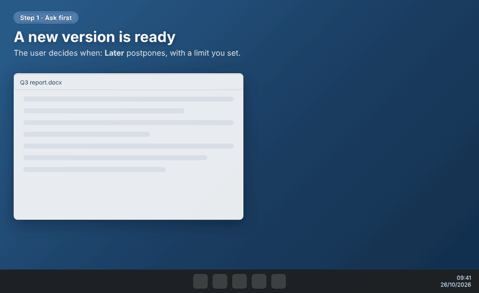
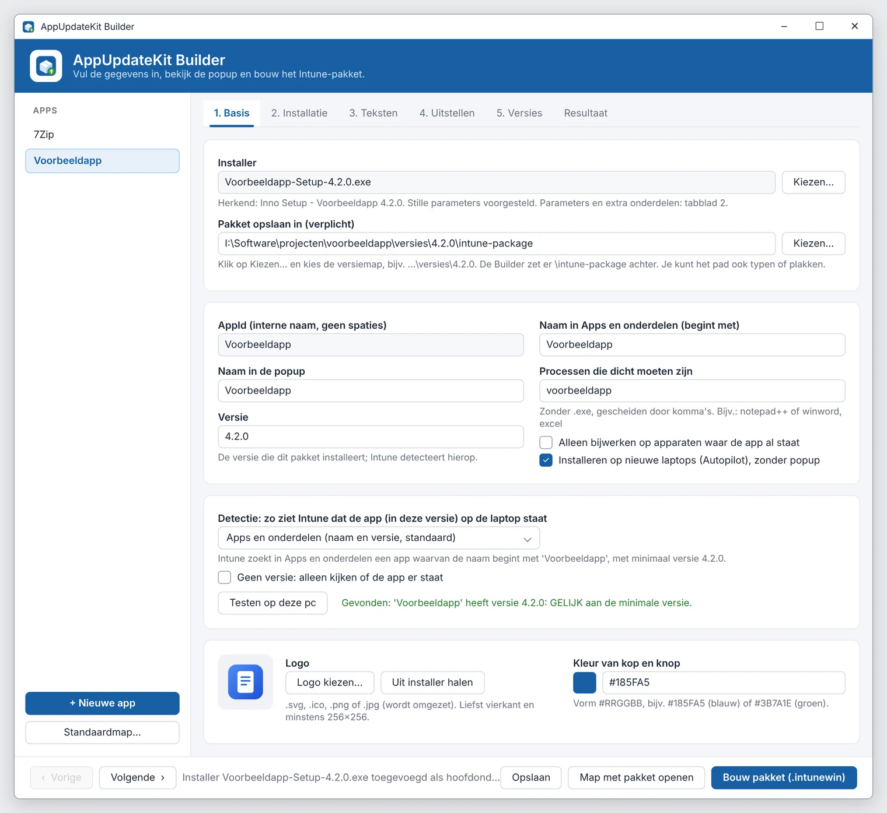
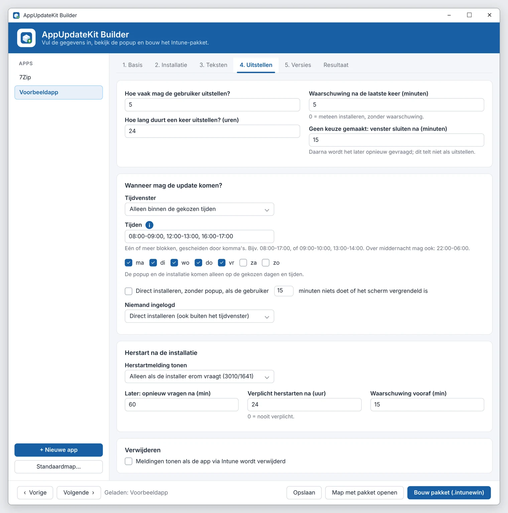

# AppUpdateKit

**Intune Win32 app updates that ask the user first.** You get a consent popup, a postpone option, a countdown, progress and result notifications, and a restart prompt with a deadline. A GUI Builder writes the install, uninstall, detection and requirement scripts for you.

> 🇳🇱 The Builder, the popups and the full manual ([LEESMIJ.md](LEESMIJ.md)) are in Dutch. Every text the user sees can be edited, so the popups can be in any language.
>
> 📖 Walkthrough with screenshots (in Dutch): [AppUpdateKit: app-updates via Intune met een nette popup](https://fonferek.cloud/blog/appupdatekit-app-updates-met-popup-in-intune/)

<p align="center">
  
</p>

## Sound familiar?

If you deploy and update apps with Intune, you have probably run into some of these:

- **Updates arrive while people are working.** Intune installs a Win32 app when it decides to. The app gets closed, or the installer fails because the app is open, and the user has no idea what happened.
- **There is no "Later" button.** Intune has no built-in way for users to postpone a Win32 app update. It only offers a grace period for restarts.
- **Users see nothing.** The installer runs as SYSTEM, so there is no window, no progress bar and no "done" message. The service desk gets the calls.
- **Every app needs a new script.** Each one needs an install command, silent switches, exit codes, a detection rule and a requirement rule. You copy the last script and adjust it, and every package ends up slightly different.
- **Uninstalling leaves things behind.** The install script created shortcuts, registry values or a scheduled task, or copied files, but nobody wrote the matching uninstall steps.
- **Changing one word means repackaging.** A different parameter or message means a new `.intunewin`, a new upload and more waiting.
- **Small mistakes cost a deployment cycle.** One wrong silent switch, such as `msiexec ... /s`, fails with exit code 1639, and you only find out after Intune has tried it.
- **Autopilot gets in the way.** A popup during the Enrollment Status Page is the last thing you want on a brand-new laptop.

## How AppUpdateKit solves this

| Problem | How the kit handles it |
|---|---|
| The app is open during the update | The kit checks the app's processes first. If the app is open, the user gets the popup and Intune tries again later (exit 1618), instead of the app being killed. |
| There is no way to postpone | Users get a **Later** button, with a limit you set (for example 5 times, 24 hours each). After the last postpone, a countdown warning appears and then the update installs. |
| Users don't know what's happening | Popups appear in the user's session, even though the install runs as SYSTEM: update available, installing (with progress), and installed or failed. They show your logo and accent colour. |
| Updates arrive during working hours | You can set a time window: only during, or only outside, the hours and days you choose. The update can also install straight away when the user is idle, the screen is locked or nobody is logged on. |
| Restarts | The restart prompt appears always, or only when the installer asks for it (3010/1641). It has **Restart now** and **Later** buttons, a deadline and a final countdown. Intune gets exit code 0, so the user doesn't get a second restart prompt from Intune. |
| Every app needs a new script | The **Builder** reads the `.msi` or `.exe` (MSI, NSIS, Inno Setup, InstallShield or WiX) and fills in the name, version and silent switches. It generates `install-app.cmd`, `uninstall-app.cmd`, the detection script, the requirement script and an `Intune-instellingen.txt` file with every setting to enter in Intune. |
| Several things to install (a runtime, the app, a config script) | One table lists the components in install order, each with its own parameters and accepted exit codes. If one fails, the install stops with that exit code. |
| Uninstalling leaves things behind | For each extra component, the Builder writes the undo steps: `msiexec /x` for an MSI, uninstall by name for an EXE, and `reg delete` for a `.reg` file. **It also reads your own `.ps1` and `.cmd` scripts** and undoes what they create: shortcuts, files and folders, registry values, scheduled tasks, services, firewall rules and environment variables. Anything it can't undo is flagged with its line number. |
| Repackaging for a small change | With the PowerShell script installer, `Install.ps1` and `Uninstall.ps1` hold the settings, texts, parameters and steps. You change them in Intune without repackaging. |
| Mistakes that only show up in production | The build checks for mistakes first, such as msiexec switches that don't exist. It stops with a clear message instead of failing on 500 laptops. |
| Autopilot | The kit detects OOBE and the ESP, using the same checks as PSAppDeployToolkit 4, and installs silently during setup. One Intune app covers both new laptops and updates. |
| "Which version did we ship?" | Every build is kept, with a full copy and build info. Earlier builds of the same version go to an archive. You can view, compare and rebuild any of them. |

<p>
  
  
</p>

## How it works

```
Intune ──► Requirement.ps1 ──► Install.ps1 (PowerShell script installer)
             │                   │
             │                   ├─ app open?        → user gets the popup, Intune retries later
             │                   ├─ consent popup    → Later (postpone) / Update now
             │                   ├─ last postpone    → countdown, then install
             │                   ├─ components       → runtime, app, scripts, in order, with exit codes
             │                   ├─ notification     → installed / failed
             │                   └─ restart prompt   → only if needed, with a deadline
             └─ time window, "only update where the app is already installed", Autopilot
```

Everything that is the same for every app lives in `_Kit\`: the popups, the postpone logic, the restart prompt and the Intune scripts. Each app only needs an `app.psd1` file and its installers. If you change something in `_Kit\` and rebuild, every app gets the change.

## Quick start

1. **Get the kit.**
   ```powershell
   git clone https://github.com/Fonfey/AppUpdateKit.git C:\AppUpdateKit
   ```
   Or choose *Code* → *Download ZIP*, extract it, and unblock the downloaded files:
   ```powershell
   Get-ChildItem C:\AppUpdateKit -Recurse | Unblock-File
   ```
2. **Start the Builder** by double-clicking `Start-Builder.cmd`.
3. **Create an app.** Click *+ Nieuwe app*, choose the installer, fill in the processes and choose a logo. Use the preview buttons to check the popups.
4. **Build the package** with *Bouw pakket*. On the first build, the Builder offers to download Microsoft's `IntuneWinAppUtil.exe`.
5. **Upload it to Intune** as a Win32 app:
   - the package: `install.intunewin`
   - installer type PowerShell script: `Intune\Install.ps1` and `Intune\Uninstall.ps1`
   - requirement and detection scripts: `Intune\Requirement.ps1` and `Intune\Detection.ps1`

   `Intune-instellingen.txt` lists every other setting.

Prefer not to use the Builder? `1-Nieuwe-app.ps1` and `2-Bouw-pakket.ps1` do the same from PowerShell.

## Versions and updates

The kit has a version number (`VERSION`, for example `1.0.0`). The Builder shows it at the top, and every build records it in `Bouwinfo.txt` and `Install.ps1`, so you can always see which kit version a package was built with. [CHANGELOG.md](CHANGELOG.md) lists what changed in each version.

Updates are published as [releases](https://github.com/Fonfey/AppUpdateKit/releases). When a new release is out, the Builder tells you at the top (it checks at most once a day). To update:

- Click **Kit bijwerken...** at the bottom left of the Builder, or double-click `Kit-bijwerken.cmd`. It shows what's new and updates to the latest release:
  - If you cloned the kit with Git, it fetches the release with Git.
  - If you downloaded a ZIP, it downloads the release and replaces the kit files.

Your own work is never touched. `Apps\`, `Output\`, `_Kit\Instellingen.psd1` and `_Kit\Standaardteksten.psd1` are not in Git. The kit creates the last two from the `*.standaard.psd1` files the first time you use it. Packages you have already built don't change: rebuild an app to give it the new kit version.

## What's in the repo

| Path | What it is |
|---|---|
| `Start-Builder.cmd`, `AppUpdateKit-Builder.ps1` | The Builder (WPF): apps, popup previews, builds and version history |
| `Kit-bijwerken.cmd`, `Kit-bijwerken.ps1` | Updates the kit to the latest version on GitHub |
| `1-Nieuwe-app.ps1`, `2-Bouw-pakket.ps1` | The same as the Builder, without the user interface |
| `_Kit\` | The scripts every package gets: popups, postpone logic, restart prompt, Intune scripts, default settings and texts |
| `_Template\` | The template for a new app |
| `Apps\`, `Output\` | Empty folders for your apps and built packages (not in Git) |
| `LEESMIJ.md` | The full manual (in Dutch), including a troubleshooting section |
| `VERSION`, `CHANGELOG.md` | The kit version and what changed per version |
| `LICENSE` | MIT licence |

## Requirements

- Microsoft Intune with Win32 apps
- Windows 10 or 11 laptops with Windows PowerShell 5.1 (built in)
- For building packages: Windows with PowerShell 5.1 and `IntuneWinAppUtil.exe` (the Builder offers to download it)

## Questions and ideas

Open an [issue](https://github.com/Fonfey/AppUpdateKit/issues). Pull requests are welcome. Every change is reviewed before it is merged.

## License

[MIT](LICENSE). You can use, change and share the kit, including inside your organisation, as long as the copyright notice and licence text stay with it.
